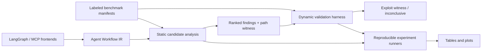

# AgentLint: Research Design and Approval Gate

**Status:** Proposed — no framework code, benchmarks, or directory scaffold has been implemented.

## 1. Research Question and Claim

**Question.** Can a framework-independent analysis identify *exploitable* time-of-check-to-time-of-use (TOCTOU) flaws in LLM-agent tool workflows, while providing actionable witnesses and measured accuracy across frameworks?

**Target claim.** AgentLint statically finds candidate stale-decision paths in agent workflows and dynamically validates a subset by replaying the workflow while mutating the checked external state. The contribution is not merely an agent-security linter: it is a workflow-level semantics, a labeled benchmark, and evidence-backed exploitability assessment.

This directly follows the observation in *Mind the Gap: Time-of-Check to Time-of-Use Vulnerabilities in LLM-Enabled Agents* that agent tool calls create exploitable gaps. The proposed work must establish its distinct contribution empirically: automated detection, cross-framework normalization, reproducible labels, and validation witnesses.

## 2. Scope, Threat Model, and Non-goals

### 2.1 Protected workflow

An agent executes an ordered or branching workflow of tool calls. A **check** reads or validates security-relevant external state. A later **use** performs a consequential action whose authorization, target, value, or safety depends on that earlier state.

The attacker can mutate a declared mutable resource after the check and before the use, or can cause an interleaving through tool latency, retries, callbacks, parallel branches, human approval, or replanning. The attacker does not compromise the agent runtime, forge tool results, or break tool authentication. Dynamic experiments use isolated mock services; no public service is attacked.

### 2.2 Non-goals

- Proving correctness for arbitrary Python, arbitrary LLM reasoning, or opaque remote tools.
- Claiming an alert is exploitable without a stated attacker capability and validation result.
- Automatically exploiting real third-party deployments.
- Replacing runtime reference monitors; AgentLint identifies workflow-level hazards and suggests binding/refresh patterns.

These limits keep claims defensible. The paper should report coverage and unsupported constructs rather than silently treating unknown behavior as safe.

## 3. Formal Taxonomy

An **agentic TOCTOU instance** is a tuple

`<c, u, r, d, g, m, k>`

where `c` is a check event, `u` a use event, `r` a mutable external resource, `d` a data/control dependency from `c` to `u`, `g` a feasible interleaving gap, `m` an attacker mutation, and `k` a security consequence. A vulnerability exists when mutation `m(r)` between `c` and `u` can cause `u` to violate the security property checked at `c`.

| Class | Check → use shape | Mutation surface | Consequence |
| --- | --- | --- | --- |
| A1: authorization drift | ACL/ownership check → write/delete/transfer | ACL, role, ownership | unauthorized action |
| A2: target substitution | path/URL/object validation → dereference/execute | symlink, redirect, identifier binding | confused target / execution |
| A3: integrity drift | hash/schema/policy check → consume/deploy | content, metadata, policy | malicious or invalid input accepted |
| A4: value drift | price/quota/balance check → purchase/allocate | API/database value | financial or resource loss |
| A5: context/retrieval drift | retrieve/summarize context → tool action | document, memory, plan state | stale or attacker-influenced action |
| A6: multi-agent handoff drift | agent A validates → agent B acts | shared store/message | trust transfer violation |
| A7: retry/replan drift | validate → delay/retry/replan → act | any above | stale decision amplified |
| A8: parallel/interleaving drift | check on one branch → use after join | concurrent actor | race-enabled violation |

Taxonomy labels are multi-label: A2 and A3 may co-occur. Each benchmark item must state resource identity, mutation capability, safety invariant, expected detection category, and patch strategy.

## 4. Architecture



### 4.1 Framework-independent Agent Workflow IR (AWIR)

AWIR is the research core. It preserves workflow semantics needed for TOCTOU without copying framework internals. Nodes are: `ToolCall`, `Decision`, `LLMPlan`, `StateRead`, `StateWrite`, `Join`, `Fork`, `Retry`, `Wait`, `HumanGate`, and `Unknown`. Edges encode control flow, data flow, exception flow, and happens-before constraints.

Each node carries:

- Stable node ID and source provenance.
- Input/output value references and abstract types.
- Resource descriptors: scheme, authority, path/key, mutability, and alias class.
- Effect summary: read, validate, authorize, write, execute, send, spend, or unknown.
- Trust label: trusted, external, attacker-controlled, unknown.
- Concurrency and retry annotations.

The IR represents an LLM decision as an explicit nondeterministic `LLMPlan` node with declared inputs and possible tool-call outputs; it never assumes natural-language reasoning is semantically stable. This is more general than AST-only scanning and lets frontends be evaluated for fidelity independently.

### 4.2 Frontends

**LangGraph frontend:** parse graph construction and known node patterns from Python AST; recover edges, conditional routing, state fields, and tool wrappers. Unresolved dynamic graph construction becomes `Unknown` with a documented confidence downgrade.

**MCP-style frontend:** ingest a declarative workflow manifest plus MCP tool schemas/trace events. MCP servers alone do not define orchestration; therefore the frontend must not claim to infer a workflow from a tool schema in isolation. The initial supported artifact is a JSON/YAML call trace or client-side workflow declaration with schemas used for effect annotation.

This constraint avoids an overclaim reviewers will identify immediately. It also creates a clean trace-assisted extension point for real repositories.

### 4.3 Static analysis

1. Construct an interprocedural control-flow graph over AWIR, including exceptional and retry edges.
2. Infer resource aliases using normalized descriptors plus configurable conservative may-alias rules.
3. Propagate taint and derived values from external reads through SSA-style value definitions.
4. Identify check nodes from effect summaries and API/semantic rules (for example, `stat`, `get_acl`, `verify_hash`, price comparison).
5. Search feasible paths from each check to security-sensitive uses where (a) the same/may-alias resource appears, (b) the check result data- or control-depends into the use, and (c) a mutable gap exists.
6. Suppress a candidate only with an explicit revalidation, immutable/version-pinned reference, atomic server-side operation, or proven synchronization/binding.
7. Emit a minimal path witness, classification, assumptions, confidence, and remediation class.

The analysis is a monotone, context-bounded abstract interpretation. Let `N` be IR nodes, `E` edges, `V` abstract values, and `A` alias classes. With a finite lattice and `k`-call-string context, worst-case propagation is `O(k * E * V * A)`; path witness minimization is bounded shortest-path work per report. The implementation will report actual graph size and analysis time, not only asymptotics.

### 4.4 Severity model

Severity is an interpretable 0–100 score, not a replacement for CVSS:

`score = 0.30 impact + 0.25 attacker_control + 0.20 gap_exposure + 0.15 reachability + 0.10 confidence`.

Each component is ordinal with documented anchors. Impact derives from effect class; attacker control from mutation preconditions; gap exposure from `Wait`, retries, network calls, and concurrency; reachability from path constraints; confidence from frontend/alias certainty and dynamic witness status. Scores are calibrated only on training/development cases, with a held-out test set untouched until final evaluation. Report component values and sensitivity analyses—black-box learned severity models would undermine auditability and risk benchmark overfitting.

### 4.5 Dynamic validation

The dynamic engine turns a static candidate into a controlled experiment. It uses resource adapters (`file`, `HTTP mock`, `key-value store`, `queue`) with deterministic mutation hooks. At the post-check barrier it applies a declared state mutation, resumes execution, and evaluates a benchmark-specific safety oracle.

Each run records seed, schedule, mutation, request/response hashes, event trace, oracle result, and environment version. The validator reports **confirmed**, **not reproduced**, or **inconclusive**—never “safe” solely because a finite schedule failed. It uses repeated seeded schedules and optional systematic interleavings for small workflows. This distinction is scientifically necessary because timing nondeterminism otherwise biases false-negative claims.

## 5. Benchmark: AgentTOCTOU-Bench

### 5.1 Corpus plan

Start with 36 paired workflows (72 artifacts): 8 classes × 4–5 cases, divided across LangGraph-like and MCP-style workflows. Each vulnerable workflow has a semantically comparable patched version. Cases include files, object stores, HTTP APIs, shared state, financial-like APIs, retrieval, retries, and parallel branches. A 75/25 development/held-out split is fixed by a published seed before analysis-rule tuning.

Each case includes: executable isolated workflow, manifest, taxonomy labels, ground-truth source span and `check/use/resource` tuple, attacker model, mutation schedule, oracle, expected remediation, and provenance/license. All synthetic examples are clearly labeled. Real-world-inspired examples are not presented as discovered vulnerabilities.

### 5.2 Labeling and quality control

Two independent annotators label every item using a written guide. Disagreements are adjudicated and Cohen’s kappa is reported. A case cannot be labeled vulnerable unless its safety oracle is violated under the documented mutation. Patches must be tested to preserve benign task success and block the oracle violation.

This paired design measures detection and remediation robustness, not simply pattern recognition. It is a stronger evaluation artifact than a collection of unverified snippets.

## 6. Experiments and Statistical Plan

Every experiment directory will contain `config.yaml`, `README.md`, `runner.py`, generated `results.csv`, and a generated `plots/` directory. The CSV and plots are generated, not hand edited. Configurations pin Python/package versions, corpus revision, seed list, machine metadata, and command line.

| Experiment | Primary evidence | Metrics |
| --- | --- | --- |
| E1 benchmark detection | accuracy on held-out paired corpus | precision, recall, F1, FP, FN, per-class CIs |
| E2 dynamic confirmation | whether candidates yield witnesses | confirmation rate, schedules-to-witness, overhead |
| E3 scalability | cost versus workflow size/density | wall time, peak memory, timeout rate |
| E4 ablation | necessity of analysis components | delta F1 / confirmation rate without alias, dependency, concurrency, validation |
| E5 frontend robustness | transfer across syntax/framework styles | parse fidelity, detection by frontend |
| E6 open-source study | ecological validity | candidates triaged, confirmed in local harness only, disclosure status |

Use stratified bootstrap 95% confidence intervals for precision/recall/F1, paired tests for ablations, and at least 30 runs for timing distributions where feasible. Pre-register detection rules and split before evaluating held-out data. Baselines: (1) lexical check/use rule matcher, (2) CFG-only no-dependency analysis, (3) static AgentLint, and (4) static plus dynamic validation. If a meaningful existing agent-security scanner has comparable inputs, include it; otherwise state the incompatibility rather than manufacture a baseline.

## 7. Ethics and Responsible Disclosure

Open-source evaluation begins with passive source analysis and local reproduction only. Targets require permissive licenses and an explicit scope record. No mutation against public endpoints, no credentials, no production tool calls, and no automated disclosure. Potential findings receive manual validation, maintainer contact through a coordinated-disclosure process, and redaction until a fix or agreed timeline. The paper separates confirmed issues, plausible candidates, and unsupported cases.

## 8. Reproducibility and Artifact Plan

The artifact will provide a pinned environment, one-command reproduction for each experiment, immutable corpus manifests, deterministic mock services, raw results, figure/table generators, unit tests, integration tests, and a hardware/software manifest. The paper will cite a release tag and archive. Continuous integration runs unit tests, schema validation, a small benchmark smoke test, and deterministic-output checks.

No result figure or table is manually produced. The artifact package is structured for USENIX/ACM artifact evaluation and includes a `README`, quick-start, expected runtimes, troubleshooting, and an explicit nondeterminism policy.

## 9. Proposed Repository Layout (for approval)

```text
agentlint/      public package and CLI
papers/         literature notes and bibliography sources
benchmark/      manifests, workflows, labels, oracles
examples/       small instructional workflows
parser/         frontend implementations
ir/             AWIR schema, builder, validators
static/         abstract interpretation and reporting
dynamic/        schedulers, adapters, validation oracles
experiments/    reproducible E1–E6 directories
results/        generated raw experiment outputs
plots/          generated cross-experiment figures
docs/           designs, APIs, taxonomy, methodology
artifact/       packaging and artifact-evaluation guide
paper/          manuscript sources, generated tables/figures
scripts/        reproducible utilities
tests/          unit, integration, and regression tests
```

Every implementation module will be accompanied by: an API document, a design document, unit tests, a microbenchmark or benchmark integration, a reproducible experiment hook, method/pseudocode/complexity text, figure/table inputs where relevant, an evaluation plan, and threats to validity. “Benchmarks” for pure data models will be explicit performance microbenchmarks rather than artificial end-to-end cases.

## 10. Incremental Milestones and Approval Gates

1. **M0 — Foundation:** scaffold, packaging, schema conventions, CI, and reproducibility contract.
2. **M1 — Semantics:** AWIR schema/validator and hand-authored workflow fixtures; validate graph and provenance invariants.
3. **M2 — Frontends:** LangGraph subset and trace/manifest MCP frontend; measure extraction fidelity.
4. **M3 — Static core:** dependency/alias/check-use analysis with path witnesses; evaluate on frozen development corpus.
5. **M4 — Dynamic core:** deterministic adapters, mutation scheduler, safety oracles, and witness recording.
6. **M5 — Corpus and experiments:** paired benchmark, statistical runners, automatic plots/tables, ablations.
7. **M6 — External study and artifact:** ethics-reviewed repository triage, documentation, paper and artifact release rehearsal.

Before each milestone’s implementation, write a focused module design in `docs/design/` and obtain approval. Each milestone has a standalone test command and acceptance criteria. This document is the required approval gate for M0 only.

## 11. Reviewer Risks, Limitations, and Mitigations

| Likely reviewer concern | Design response |
| --- | --- |
| “This is just classical TOCTOU.” | Show agent-specific semantics: LLM planning, tool schemas, retries, handoffs, and asynchronous workflow graphs; quantify their incremental value via ablation. |
| “Static results are false positives.” | Require path witnesses, state assumptions, and dynamic confirmation where executable; report unconfirmed candidates separately. |
| “Benchmark is synthetic.” | Publish paired executable cases, label rigor, and carefully scoped open-source triage; avoid inflated claims. |
| “Framework coverage is shallow.” | Define supported subsets precisely, measure frontend fidelity, and retain unknown constructs conservatively. |
| “Dynamic validation is flaky.” | Use deterministic mock adapters, seeded schedules, repeated trials, and three-valued outcomes. |
| “Severity is arbitrary.” | Make it interpretable, publish anchors, and conduct sensitivity/calibration analysis. |

Future work: richer symbolic resource modeling, language-independent trace extraction, model-aware plan uncertainty, runtime enforcement synthesis, and longitudinal measurement of disclosures/remediations.

## 12. Approval Requested

If approved, implementation starts only with M0’s focused design document (`docs/design/m0-foundation.md`), then the requested directory scaffold and reproducibility skeleton. No analysis module, benchmark workflow, or dynamic mutation capability will be implemented before its corresponding approved design.
