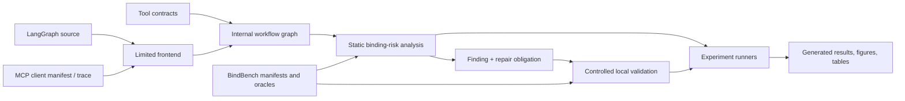

# AgentLint: Final Project Specification

**Status:** frozen research and engineering specification. It may change only to clarify implementation details that do not alter the scope, claims, datasets, hypotheses, or evaluation protocol below.  
**Target:** reputable regional IEEE conference.  
**Decision:** **READY TO IMPLEMENT**, subject to approval of this frozen specification.

## 1. Purpose and Honest Positioning

AgentLint is an engineering and empirical research framework for analyzing **check–effect binding risks** in LLM-agent tool workflows. It helps developers identify workflows in which an agent checks mutable external state, later performs a dependent effect, and has no modeled protection ensuring that the effect still applies to the checked state.

TOCTOU is the primary motivating vulnerability class. The project builds on prior work rather than competing with it:

- *Mind the Gap* establishes agentic TOCTOU, provides TOCTOU-Bench, and evaluates sequence-based monitoring and mitigations ([Lilienthal and Hong, 2025](https://arxiv.org/abs/2508.17155)).
- *Atomicity for Agents* formalizes stale target binding in browser-use agents and uses deterministic update schedules and task-specific oracles ([Jiang et al., 2026](https://arxiv.org/abs/2603.00476)).
- *AgentFlow* provides a framework-agnostic agent dependency graph and static analyses across agent frameworks ([Wang et al., 2026](https://arxiv.org/abs/2607.01640)).
- Classical TOCTOU research provides check/use, atomicity, and state-machine analysis foundations; KERAT is a recent static atomicity-rule analysis for kernel TOCTOU ([Han et al., 2026](https://www.usenix.org/conference/usenixsecurity26/presentation/han)).

AgentLint makes no claim of firstness, universal soundness, or broad framework generality. Its contribution is a practical, reproducible implementation and evaluation of explicit tool contracts, dependency-aware workflow analysis, controlled validation, and repair-oriented reporting for a limited set of agent workflows.

## 2. Research Questions

- **RQ1:** Does dependency-aware check–effect analysis with explicit binding rules identify labeled workflow risks more accurately than simple tool-pair and reachability baselines?
- **RQ2:** Do modeled binding mechanisms—revalidation, immutable/stable identity, conditional version checks, and atomic operations—reduce false positives on safe workflows with similar check/effect shapes?
- **RQ3:** Can controlled state mutation reproduce the expected invariant violation for reported vulnerable benchmark cases, while correctly showing safe repaired variants?
- **RQ4:** Can a limited LangGraph source frontend and an MCP-style client manifest/trace frontend represent the same annotated workflow property with measurable fidelity?
- **RQ5:** Do repair obligations derived from findings preserve benign task success while preventing the benchmark safety violation?

## 3. Final Scope

### 3.1 Included

- **Inputs:** Python LangGraph workflows within a documented AST subset, and MCP-style client workflow manifests or structured tool traces. MCP server schemas serve only as tool-contract hints; schema-only orchestration inference is excluded.
- **Internal workflow model:** a small attributed graph used internally for control flow, dependencies, resource references, contract annotations, and source/trace provenance. It is an implementation model, not an IR research contribution.
- **Tool contracts:** explicit YAML/JSON descriptions for supported tools: resource argument, operation (`read`, `check`, `effect`, `write`), predicate, effect, binding capability, and authority behavior.
- **Binding mechanisms:** revalidation immediately before effect; stable immutable/capability identity; version/ETag/conditional precondition; atomic authority operation; and modeled synchronization.
- **Analysis:** configured static data/control-dependency and resource-alias checks over the internal workflow model; findings include an explanation path, assumptions, confidence/coverage status, and repair obligation.
- **Validation:** deterministic local adapters for a file-like store, versioned key–value store, and HTTP-like mock service. A validator applies a declared mutation at a declared barrier and evaluates a benchmark-specific safety oracle.
- **Corpus:** `BindBench`, a self-contained suite of 24 scenario families, each with vulnerable, repaired, and safe-near-miss variants (72 workflow artifacts). It is an evaluation suite, not claimed as a general public benchmark or a replacement for TOCTOU-Bench/DYNWEB.
- **Experiments:** detection, binding ablation, controlled validation, frontend-property fidelity, repair utility, and runtime/scalability measurement.
- **Reproducibility:** pinned environment, deterministic test adapters, versioned contracts/corpus, generated tables/figures, unit and integration tests, and experiment-specific configurations.

### 3.2 Excluded

- New generic IR, generic workflow-analysis theory, or a claim of cross-framework universality.
- Browser-use/DOM/layout TOCTOU, which is covered directly by *Atomicity for Agents*.
- Schema-only MCP analysis, arbitrary Python reflection, opaque tools, arbitrary LLM reasoning, or proof of safety for production agents.
- Prompt injection, memory poisoning, tool poisoning, capability governance, and generic agent-security scanning.
- Severity scoring, CVSS mapping, automatic repair/patch generation, and real-world exploitation.
- A requirement to find or disclose real vulnerabilities. An optional local-only repository case study is allowed only if time permits and follows the ethics protocol.

## 4. Threat Model and Safety Property

### 4.1 Attacker capability

For a benchmark case, an attacker or concurrent actor may mutate a declared mutable resource after a check and before its dependent effect. The actor may change a value, identity resolution, permission, availability, or version. It cannot compromise the local runtime, forge a trusted tool response, or bypass the modeled resource authority.

### 4.2 Check–effect binding risk

A check establishes `assertion = (resource, predicate, observed_version, provenance)`. A later effect is considered protected if one of the following is modeled:

1. the authority performs check and effect atomically;
2. the effect carries an authority-enforced version/ETag/conditional token;
3. the effect uses a stable capability or immutable resource identity;
4. the resource is rechecked at the enforcing authority immediately before the effect; or
5. a modeled lock, lease, transaction, or synchronization excludes permitted mutation.

AgentLint reports a **candidate binding risk** when a check reaches a dependent effect on the same/may-alias resource, the resource can be mutated in the intervening workflow path, and no modeled protection applies. This is a diagnostic result, not a proof of exploitability. A **validated case** is one whose declared local mutation schedule violates its safety oracle. A missing witness is reported as `not_triggered_within_budget` or `inconclusive`, never `safe`.

## 5. System Design

### 5.1 Tool-contract schema

Every supported tool has a contract with:

- operation and resource-argument mapping;
- produced or required predicate;
- resource identity form and version field, if any;
- accepted binding mechanism(s);
- authority behavior (`enforced`, `advisory`, or `unknown`);
- effect category and optional safety-oracle reference.

Contracts are explicit because tool schemas and source names alone cannot reliably reveal authority semantics. Missing or unknown contracts lower coverage and are never interpreted as proof of safety.

### 5.2 Static analysis

The analyzer:

1. extracts supported workflow edges and tool calls;
2. attaches contracts and normalizes resource references;
3. computes direct data/control dependencies and conservative resource aliases;
4. propagates check assertions through the graph;
5. discharges assertions only when a modeled binding mechanism applies; and
6. emits a minimal explanation path and repair obligation.

The core implementation uses deterministic worklist propagation. With `E` workflow edges, `R` alias classes, `P` predicate classes, and context bound `k`, its modeled propagation has `O(k × E × R × P)` abstract updates. This is an engineering complexity bound for the supported subset, not a formal soundness claim.

### 5.3 Repair obligations

Each finding recommends a property rather than an automatic patch:

- pass a checked version as an authority-enforced precondition;
- use a conditional/atomic operation;
- hold a stable identity/capability instead of re-resolving a mutable name;
- revalidate at the authority; or
- synchronize the interval.

The corpus supplies manually authored repaired variants. Evaluation measures the stated property: task success remains intact and the declared safety oracle no longer fails.

### 5.4 Controlled validation

The validator is test infrastructure. It records the corpus revision, contract revision, seed, mutation, barrier, trace, observed versions, and oracle result. It does not claim a novel exploit engine or establish the absence of a vulnerability.

## 6. Dataset: BindBench

### 6.1 Composition

`BindBench` contains 24 scenario families. Each family includes exactly three variants:

- **Vulnerable:** an unprotected check–effect dependency with an executable local mutation and failing safety oracle.
- **Repaired:** a binding mechanism is added; benign task oracle passes and the defined mutation no longer violates safety.
- **Safe near-miss:** check/effect shape remains, but an existing authority binding makes the mutation ineffective or rejected.

Families are balanced across the following six categories (four families each):

| Category | Required binding contrast |
| --- | --- |
| file/object identity | name/path re-resolution vs stable object/capability |
| versioned key–value state | read–write vs compare-and-swap/version token |
| HTTP-like resources | GET/act vs ETag or conditional request |
| authorization | pre-check permission vs enforcement-time recheck/conditional authority |
| value/availability | stale price/quota/stock vs atomic conditional action |
| workflow control | retry, join, or callback gap vs revalidation/synchronization |

At least 12 families have both a LangGraph-source and MCP-style manifest/trace representation. The corpus may include small, legally permitted adaptations inspired by published examples, but every artifact is self-contained and its source/provenance is recorded. It does not copy or relabel TOCTOU-Bench or DYNWEB as original work.

### 6.2 Labeling and split

Two annotators independently label each family’s resource, check, effect, mutation, existing binding, expected result, and repair obligation. Report Cohen’s kappa and adjudication notes. The split is by family: 16 development families and 8 held-out families, fixed before tuning analysis rules. All three variants of a family stay in the same split.

## 7. Baselines and Evaluation Protocol

### 7.1 Baselines

| ID | Baseline | Purpose |
| --- | --- | --- |
| B1 | ordered read/check → effect pair matcher on same named resource | practical approximation of broad sequence heuristics used in prior agentic TOCTOU work |
| B2 | B1 plus workflow reachability | measures value beyond adjacent tool-pair matching |
| B3 | dependency and alias analysis without binding rules | isolates the practical contribution of modeled bindings |
| B4 | full AgentLint analysis | proposed engineering method |

Existing systems are discussed and cited but are not forced into invalid numerical comparisons: Mind the Gap’s runtime FSA has different inputs, Atomicity targets browser interaction, and AgentFlow targets agent dependency/governance risks. If their code and inputs later become directly compatible, results may be added as a supplementary qualitative comparison, but they are not required for the frozen evaluation.

### 7.2 Metrics

- Family-level precision, recall, F1, false positives, and false negatives for B1–B4.
- Per-category precision/recall/F1 and macro-F1.
- Binding-ablation delta in FP/FN and F1 (`B3` vs `B4`).
- Validation outcome counts: `validated`, `not_triggered_within_budget`, `inconclusive`; schedules attempted; validation time.
- Repair utility: benign task-success rate and safety-oracle violation rate for vulnerable vs repaired variants.
- Frontend property fidelity: exact match of annotated tool calls, workflow edges, resource references, and contract attachments; unknown-construct rate.
- Runtime: median/p95 analysis time, peak memory, and timeout rate across controlled workflow size/density series.
- Annotation agreement: Cohen’s kappa and adjudication count.

Report raw counts and family-level stratified bootstrap 95% confidence intervals for precision, recall, and F1. Do not treat paired variants as independent samples. Repeat timing trials 30 times; static detection results remain deterministic and do not require repeated seeds.

## 8. Experiments, Generated Outputs, and Reproducibility

Every experiment lives under `experiments/<name>/` and contains `config.yaml`, `README.md`, `runner.py`, generated `results.csv`, and generated `plots/`.

| ID | Experiment | Dataset / input | Baselines | Primary metrics | Required generated output |
| --- | --- | --- | --- | --- | --- |
| E1 | detection accuracy | held-out BindBench families | B1–B4 | P/R/F1, FP/FN, macro-F1 | `table_detection.csv`, per-category bar chart |
| E2 | binding ablation | all BindBench families, family split preserved | B3 vs B4 | F1/FP/FN deltas | ablation table and delta chart |
| E3 | controlled validation | vulnerable and repaired BindBench variants | B4 findings | validation outcomes, schedules, time | witness-outcome table and schedule-cost plot |
| E4 | repair utility | vulnerable/repaired pairs | n/a | task success, safety violations | paired repair table and grouped bar chart |
| E5 | frontend fidelity | 12 dual-representation families | source vs manifest/trace | call/edge/resource/contract fidelity, unknown rate | fidelity table and radar/bar chart |
| E6 | scalability | generated graph-size/density fixtures with fixed contracts | B2–B4 | median/p95 runtime, memory, timeouts | scaling table and log-scale runtime plot |

### 8.1 Required figures

1. Architecture diagram.
2. Check–effect binding example showing vulnerable, repaired, and safe-near-miss variants.
3. Detection precision/recall/F1 by baseline and category.
4. Binding-ablation false-positive/false-negative change.
5. Controlled-validation outcomes and schedule cost.
6. Repair utility comparison.
7. Frontend property fidelity.
8. Runtime/scalability curves.

### 8.2 Required tables

1. Scope and prior-work positioning table.
2. Supported tool-contract fields and binding mechanisms.
3. BindBench composition and label distribution.
4. Detection results with raw counts and confidence intervals.
5. Ablation results.
6. Validation outcomes and reproducibility metadata summary.
7. Repair-utility results.
8. Frontend fidelity and unsupported-construct coverage.
9. Runtime/memory results.
10. Limitations and threats-to-validity matrix.

### 8.3 Reproducibility requirements

- A pinned Python environment and lockfile.
- Versioned corpus, contract, and generated-result manifests.
- Deterministic local adapters and fixed mutation schedules.
- Seed, machine metadata, command line, and timeout recorded per run.
- One command per experiment to regenerate CSVs, figures, and tables.
- Unit tests for each module, integration tests for each end-to-end corpus category, and regression tests for reported findings.
- CI for schema validation, tests, one smoke experiment, and generated-artifact consistency.

## 9. Milestone Plan and Acceptance Criteria

Every milestone begins with a focused design document and ends with documentation, unit tests, API documentation, a microbenchmark or experiment hook, and an acceptance review. The folder structure requested by the user is created in M0.

| Milestone | Deliverables | Acceptance criteria | Paper material |
| --- | --- | --- | --- |
| **M0 — Foundation** | repository layout; package config; CI; reproducibility conventions; experiment template; documentation index | clean installation; CI passes; template regenerates an empty result artifact | Implementation/reproducibility paragraph; artifact appendix |
| **M1 — Contracts and corpus schema** | contract JSON/YAML schema; BindBench manifest schema; annotation guide; 6 pilot families | validators reject malformed contracts; two annotators complete pilot; kappa ≥ 0.70 or guide revised before full labeling | Methodology: contracts; Evaluation: dataset protocol |
| **M2 — Workflow model and static core** | internal graph model; dependency/alias propagation; B1–B4; finding/report API; 12 development families | all seeded positives found by B4; hard negative controls suppressed; B1–B4 unit/regression tests pass | Methodology: analysis; preliminary baseline table |
| **M3 — Limited frontends** | LangGraph AST-subset frontend; MCP-style manifest/trace importer; coverage matrix; dual-representation fixtures | accepted fixtures map to expected calls/edges/resources; unsupported constructs become explicit unknowns; E5 pilot runs | Implementation: frontend scope; Evaluation: fidelity method |
| **M4 — Validation and repairs** | three local resource adapters; barriers/mutations/oracles; repaired variants for all families | deterministic replay for pilot cases; vulnerable/repaired/safe variants produce expected oracle outcomes; E3/E4 pilots run | Methodology: validation; Results: repair evidence |
| **M5 — Full corpus and experiments** | all 24 families; labeling/adjudication; frozen split; E1–E6 runners; automatic plots/tables | all experiments complete from clean environment; raw results and CI logs retained; statistical outputs generated | Evaluation and Results sections |
| **M6 — Artifact and paper** | documentation; artifact package; manuscript; final limitations review; optional local-only case study if completed ethically | third party can reproduce core tables/figures; all claims link to results; no unsupported claims remain | Complete paper and artifact |

**Milestone stop rule:** a milestone that fails its acceptance criteria is fixed within its stated scope or reported as a limitation. It does not expand the research scope or add unrelated features.

## 10. Paper Outline and Milestone Mapping

| Section | Content | Primary milestone sources |
| --- | --- | --- |
| Abstract | practical problem, scope, method, measured results, reproducibility statement | M5, M6 |
| Introduction | agent tool workflows, stale-state risks, practical need, bounded contributions | M0, M1, M6 |
| Related Work | Mind the Gap, Atomicity, AgentFlow, classical TOCTOU, static analysis, agent-security evaluation | M0, M6 |
| Methodology | threat model, tool contracts, binding rules, internal model, analysis algorithm, repair obligations | M1, M2 |
| Implementation | system architecture, supported frontends, contracts, adapters, unknown handling | M0, M2, M3, M4 |
| Evaluation | BindBench protocol, labels, split, baselines, metrics, environment | M1, M5 |
| Results | E1–E6 figures/tables with raw counts and intervals | M5 |
| Limitations | manual contracts, limited frontends/resources, synthetic corpus, no absence proof, no schema-only MCP support | M3, M5, M6 |
| Future Work | broader frameworks, contract inference, browser agents, production deployment studies | M6 |
| Conclusion | bounded practical value and reproducible artifact | M5, M6 |

## 11. Claims Permitted in the Paper

The paper may claim that AgentLint:

- is an implemented, reproducible framework for the frozen subset;
- models explicit tool contracts and binding mechanisms;
- reports candidate binding risks with evidence paths and repair obligations;
- provides controlled local validation for its benchmark cases;
- evaluates its method against the stated baselines and datasets; and
- reports measured limitations and coverage.

The paper must not claim that AgentLint is first, novel in isolation, sound for arbitrary agent programs, complete, framework-independent in general, an exploit detector for real deployments, or a replacement for existing TOCTOU/agent-security benchmarks and systems.

## 12. Ethics and Safety

All mutations execute only against local deterministic adapters. No production API, external endpoint, credential, or user data is used. Any optional source-repository inspection remains passive; no exploit validation is performed outside the local harness. The paper distinguishes benchmark validation from real-world vulnerability confirmation.

## 13. Final Decision

**READY TO IMPLEMENT**

This specification removes unsupported firstness and theory claims while retaining a well-scoped, practically useful, reproducible engineering study. After approval, implementation begins at M0; changes require preserving every frozen scope, baseline, metric, and milestone criterion above.
