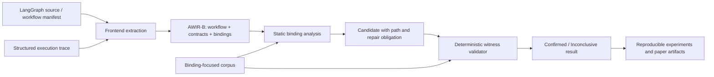

# AgentLint: Revised Research Specification

**Status:** research specification only. No implementation, project scaffolding, corpus construction, or experiments are authorized by this document.

## 1. Thesis and Positioning

### 1.1 Research objective

AgentLint will study **predicate-to-effect binding violations** in LLM-agent systems: workflows that establish a security-relevant predicate about mutable external state, then execute a security-relevant effect without a mechanism ensuring that the effect applies to the state for which the predicate was true.

Time-of-check-to-time-of-use (TOCTOU) is the primary motivating class, but it is not the entire claim. The central question is:

> Can a workflow-semantic analysis model validity predicates, resource identities, and validity bindings across agent tool chains, then produce replayable evidence when a mutation can invalidate the predicate before its dependent effect?

### 1.2 What this paper is—and is not

This is a program-analysis and systems-security paper about **workflow semantics and correctness of security decisions across tool boundaries**. It is not a claim to be the first agentic TOCTOU study, the first agentic TOCTOU benchmark, the first automated detector, or the first dynamic agent-security harness.

*Mind the Gap* already introduces agentic TOCTOU, a 66-task benchmark, trajectory-level automated detection, and mitigations including state integrity monitoring and tool fusion ([Lilienthal and Hong, 2025](https://arxiv.org/abs/2508.17155)). The browser-use setting is also addressed by *Atomicity for Agents* ([record](https://papers.cool/arxiv/2603.00476)). AgentLint’s claims therefore depend on the specific differentiators in Section 3, not on broad firstness.

### 1.3 Scope

The first artifact supports a deliberately narrow but meaningful subset:

- Explicit, source-declared workflows and structured execution traces.
- Tool operations with declared or inferred effect contracts.
- Resource classes with controllable identity/version semantics: files/object-like stores, HTTP-like resources with validators, and key–value/transaction-like stores.
- Check, bind, revalidate, synchronize, and effect operations, including branching, retries, joins, and explicit handoff.
- LangGraph-style source workflows and MCP-style client workflow manifests/traces.

It does not claim to fully analyze arbitrary Python reflection, opaque remote tools, arbitrary LLM reasoning, or MCP servers from their schemas alone. MCP schemas describe tools, not a client’s workflow; the MCP frontend must consume client-side manifest/trace evidence. Unknown behavior is represented explicitly and reported as a coverage limitation.

## 2. Threat Model and Security Property

### 2.1 Attacker model

An attacker controls or can mutate a declared mutable resource after an agent evaluates a predicate and before a dependent effect reaches the resource authority. The mutation may be through a concurrent actor, redirect/identifier substitution, API response change, retry/replan interval, callback, shared-store update, or cross-agent handoff.

The attacker cannot compromise the local agent runtime, forge authenticated tool responses, bypass the resource authority, or mutate resources outside the case-specific capability model. Dynamic validation is limited to isolated local adapters and never targets public services or real credentials.

### 2.2 Binding property

A workflow establishes an assertion

`α = (resource, predicate, observed_version, observed_at, binding)`.

A later effect is safe with respect to `α` only if it is one of the following:

1. **Atomic:** the authority evaluates the predicate and executes the effect as one operation.
2. **Version-bound:** the effect includes the observed version/ETag/conditional token and the authority rejects a changed resource.
3. **Identity-bound:** the effect operates on a stable capability/descriptor/immutable object identity, not a re-resolved name.
4. **Synchronized:** a lock, lease, transaction, or workflow synchronization prevents permitted mutations through the effect.
5. **Revalidated at enforcement:** the effect authority reevaluates the needed predicate immediately before action.

A predicate-to-effect binding violation exists when an effect depends on an earlier security predicate, the resource can transition to a predicate-violating or different identity state in between, no valid binding applies, and the effect violates the declared safety invariant.

This formulation intentionally differs from “a long time elapsed”: duration is an exposure factor, whereas lack of binding is the vulnerability condition.

## 3. Contributions and Novelty Boundaries

### 3.1 Proposed contributions

| Contribution | Scientific claim | Comparison and novelty boundary | Evidence required |
| --- | --- | --- | --- |
| C1: agent workflow binding calculus | formalizes predicate, resource identity, effect, binding, mutation capability, and witness for agent workflows | Classical TOCTOU models cover OS/file objects; *Mind the Gap* identifies agent TOCTOU but does not present this workflow-level binding calculus. Do not claim a universal first formalization until a systematic literature audit confirms it. | core-language semantics, theorem under assumptions, illustrative mappings |
| C2: AWIR-B | a framework-neutral IR that preserves effect contracts and binding state across source/manifest/trace inputs | Generic IRs/CPGs already provide language-neutral graph representations ([Joern CPG](https://cpg.joern.io/)); novelty is the contract and binding layer, not “an IR.” | schema, invariants, fidelity benchmark, coverage matrix |
| C3: binding-aware static analysis | reports check–effect paths where a mutable resource can invalidate an unbound assertion | Taint, CFG/DFG, aliasing, and abstract interpretation are established; novelty is their composition over binding-aware workflow contracts. | relative-soundness theorem for core, baselines/ablations/error taxonomy |
| C4: deterministic witness protocol | turns a candidate into a reproducible mutation schedule, trace, and invariant evaluation | Dynamic agent environments exist (e.g., [AgentDojo](https://arxiv.org/abs/2406.13352)); novelty is specific replayable predicate-invalidating witnesses, if shown reusable across resources. | adapters, public witness format, determinism and yield evaluation |
| C5: binding-focused evaluation corpus | independently labeled, paired workflows and ports that isolate semantic bindings, repairs, and near-misses | This extends—not replaces—TOCTOU-Bench; benchmark contribution requires new coverage that existing corpora lack. | licensing/provenance, inter-annotator agreement, frozen split, external ports |

### 3.2 Explicit non-claims

- Not the first study of TOCTOU in LLM agents.
- Not the first automated agentic TOCTOU detection or benchmark.
- Not the first framework-independent graph/IR or use of taint analysis.
- Not a proof of safety for arbitrary agent code, tool APIs, or LLM plans.
- Not an automatic repair system; the tool emits **repair obligations** that specify the required binding property.
- Not a generic severity-ranking paper. A severity field is deferred unless externally validated against expert judgments or deployment outcomes.

## 4. Formal Model

### 4.1 Workflow semantics

An Agent Workflow with Bindings (AWB) is a labeled transition system:

`W = (Q, q0, E, →, Γ)`

where `Q` are control states, `q0` is initial state, `E` are events, `→` is a transition relation, and `Γ` maps event types to effect contracts. Runtime state is:

`σ = (ρ, κ, η)`

where `ρ` is a resource store, `κ` is agent/workflow state, and `η` is causal/scheduling history. A resource is:

`r = (id, val, ver, auth, mut)`

with logical identity `id`, current value `val`, optional version `ver`, authority `auth`, and mutability/capability model `mut`.

Events include `Read`, `Check`, `Bind`, `Effect`, `Write`, `Fork`, `Join`, `Retry`, `Wait`, `Handoff`, `Sync`, and `Unknown`. An LLM planning action is an explicit nondeterministic event whose known inputs, selected tools, and outputs are represented; it is not assumed to make source semantics complete.

### 4.2 Contracts

An effect contract declares resource argument mapping, access mode, predicate established or required, identity representation, accepted binding mechanism, authority enforcement semantics, and potential safety invariant. A contract may be exact, conservative, or unknown. Analysis confidence and theorem scope depend on contract status.

Example abstract contracts:

`get_acl(user, object) → Check(object, permitted(user, write), version)`

`conditional_write(object, value, if_match) → Effect(object, write) requires VersionBind(if_match)`

`send_payment(account, amount) → Effect(account, debit) requires Atomic(balance >= amount)`

### 4.3 Vulnerability definition

Let `c = Check(r, φ)` and `u = Effect(r', a)` be events. Let `c ⇝ u` mean that the assertion produced at `c` reaches `u` by data or control dependence, and let `c ≺ u` mean `c` happens before `u` on a feasible path. Let `M_A` be attacker-permitted mutations and `I` the safety invariant.

`Vuln(c,u,r,φ)` holds iff there is a mutation `μ ∈ M_A` such that:

1. `r` may-aliases `r'`;
2. `c ⇝ u` and `c ≺ μ ≺ u`;
3. `μ` changes resource identity or makes `φ(r)` false;
4. no accepted atomic, version, identity, synchronization, or enforcement-time-revalidation binding remains valid; and
5. executing `u` after `μ` violates `I`.

A static **candidate** establishes/over-approximates conditions 1–4. A dynamic **witness** is a replayable execution satisfying 1–5. A failed finite validation is *inconclusive*, never a proof that `¬Vuln`.

### 4.4 Proof target

For the closed core language, exact contracts, complete aliases, and modeled scheduler/resource transitions, prove:

> Every concrete binding violation trace maps to a reported static candidate.

This is a relative-soundness property. It excludes frontend extraction, unknown tool behavior, and opaque LLM branches. The artifact must state every assumption next to the theorem; no general “sound analyzer for agent systems” claim is permitted.

## 5. System Design

### 5.1 AWIR-B

AWIR-B is an attributed multigraph with four views:

- **Workflow view:** control, exception, retry, fork/join, and happens-before edges.
- **Dependency view:** SSA-like value definitions, data dependence, control dependence, and provenance.
- **Resource view:** resource descriptors, may-alias edges, version/identity state, authority, and trust/mutability labels.
- **Binding view:** predicate assertions, binding creation, invalidation, barriers, revalidation, and effect obligations.

Each node preserves source or trace provenance and contract confidence. The `Unknown` node is a first-class terminus/edge, never silently erased. This design borrows the multi-view benefits of CPGs but adds a domain-specific semantic overlay; existing generic CPG work is a baseline, not a novelty foil.

### 5.2 Frontends and fidelity

**LangGraph source frontend.** Supports a documented AST subset for graph construction, node registration, conditional edges, standard tool nodes, state fields, and known retry/interrupt forms. It captures unresolved reflection/dynamic edges as unknown. LangGraph’s explicit graphs and tool nodes make it a defensible initial source frontend ([workflow documentation](https://langchain-ai.github.io/langgraph/how-tos/tool-calling/?h=tool)).

**MCP-style manifest/trace frontend.** Ingests a declarative client workflow, JSON/YAML manifest, or structured tool lifecycle trace plus MCP tool schemas as *contract hints*. It does not infer an orchestration from server schema alone. This is required because MCP guidance addresses tools/protocol security, while the client controls the check/effect sequence ([MCP security guidance](https://modelcontextprotocol.io/docs/tutorials/security/security_best_practices)).

**Fidelity evaluation.** Annotated gold workflows measure node identity, control and happens-before edges, effects, resource identity, binding annotations, unknown coverage, and source/trace agreement. “Parsed successfully” is not a fidelity metric.

### 5.3 Static analysis

The static analyzer uses a finite monotone domain:

`D = AliasSet × PredicateClass × BindingState × Trust × PathCondition × ContractConfidence`.

For each `Check`, it propagates an assertion through workflow/dependency edges. Transfers kill or discharge assertions on a proven revalidation, immutable/version-pinned identity, valid atomic operation, authority-enforced conditional effect, or modeled synchronization. At an effect, the analyzer reports candidates with a minimal witness path and repair obligation.

With `E` graph edges, `R` alias classes, `P` predicate classes, and context bound `k`, worklist propagation is bounded by `O(k · E · R · P)` abstract updates, excluding bounded feasibility queries. Scalability experiments must vary `k`, alias precision, graph size, and contract completeness.

### 5.4 Repair obligations

Findings do not generate patches by default. They output one or more minimal obligations:

- fuse predicate and effect at the resource authority;
- pass the checked resource version/ETag as an effect precondition;
- retain a stable capability/object handle;
- synchronize the mutation/effect interval; or
- revalidate at the enforcing authority.

The repair study evaluates manually authored implementations of these obligations for task utility and safety-oracle preservation. This is safer and more scientifically testable than automatic repair suggestions.

### 5.5 Deterministic witness validator

Each candidate names a resource adapter, mutation capability, barrier placement, seed, and safety oracle. The engine pauses after the candidate check, applies only the declared mutation, resumes the workflow, and emits a complete witness bundle: workflow/contract revision, schedule, mutation, trace, observed resource versions, oracle result, and environment digest.

Adapters must be deterministic for the same seed and configuration. Small concurrent cases may enumerate schedules; larger cases use bounded seeded exploration and report its budget. Outcomes are `confirmed`, `not-triggered-under-budget`, and `inconclusive`; paper metrics must never merge the latter two with safe/negative examples.

## 6. Corpus and Labeling Strategy

### 6.1 AgentTOCTOU-Bind

The corpus is a **binding-semantic extension**, not a smaller competing benchmark. It contains at least 40 independently specified scenario families with vulnerable, repaired, and non-vulnerable near-miss variants. If each family has variants, report families and artifacts separately to avoid inflating sample size.

Required coverage:

- version/ETag versus unbound HTTP/object effects;
- stable capability/descriptor versus name/path re-resolution;
- atomic conditional update versus read-then-write;
- retry/replan and callback invalidation;
- fork/join and handoff where a causal gap is feasible;
- resource-specific negative controls where a gap exists but an authority binding makes it safe;
- both source-declared and trace/manifest representations for selected families.

Port or adapt eligible TOCTOU-Bench cases with clear provenance/license and preserve their original labels separately. New cases must be included only when they test a documented binding semantic absent from the ported corpus.

### 6.2 Ground truth

Every case contains a threat model, resource contract, check/effect/binding tuple, mutation capability, expected invariant, deterministic oracle, repair obligation, provenance, and expected frontend coverage. Two independent annotators label the tuple and taxonomy; publish Cohen’s kappa, disagreements, and adjudication policy. A vulnerable label requires an executable local witness. A patched label requires both an unchanged benign task oracle and no safety violation under the defined mutation model.

## 7. Hypotheses, Baselines, and Experiments

### 7.1 Hypotheses

| ID | Hypothesis | Evidence |
| --- | --- | --- |
| H1 | Binding-aware workflow analysis has higher held-out F1 than lexical and CFG-only check/effect matching. | E1 plus bootstrap CIs and error taxonomy |
| H2 | Binding state accounts for exploitability beyond time-gap features alone. | matched binding-vs-delay corpus families; predictive/ablation analysis |
| H3 | Contracts, aliasing, and binding transfers each materially contribute to detection performance. | factorial ablation |
| H4 | Deterministic witnesses increase actionable precision while preserving an explicit inconclusive category. | candidate confirmation and cost/yield analysis |
| H5 | AWIR-B preserves required semantics across the two frontend forms with quantified fidelity. | gold graph/contract annotations and source–trace agreement |
| H6 | Binding-obligation repairs block violations without reducing benign task success. | paired repair-utility experiment |

Severity correlation is excluded from the main hypotheses. It can be revisited only with independent experts or real outcome labels.

### 7.2 Baselines

1. **Lexical matcher:** configurable check/effect API patterns; establishes value beyond grep-like detection.
2. **CFG matcher:** lexical matcher plus control-flow reachability; no resource dependency/binding reasoning.
3. **Dependency/alias matcher:** data/control dependency plus aliases; no binding transfer model.
4. **AgentLint static:** full contract and binding-aware analysis.
5. **AgentLint static + dynamic witness:** operational outcome layer, not a recall baseline.
6. **Published Mind the Gap detector/heuristic:** exact reproduction where code/specification permits; otherwise a clearly labeled compatible adaptation.

Semgrep/CodeQL-style rules may be evaluated only against supported source subsets. AgentDojo and MCPTox are contextual/qualitative comparison points, not accuracy baselines: their prompt-injection/tool-poisoning objectives differ.

### 7.3 Experiment suite

| Experiment | Hypotheses | Main outputs | Precondition |
| --- | --- | --- | --- |
| E1 held-out detection | H1, H3 | precision/recall/F1, FP/FN, macro/per-class CIs | frozen corpus and rule set |
| E2 deterministic witness validation | H4 | confirmed/static PPV, yield, time/schedules, inconclusive rate | validated adapters/oracles |
| E3 frontend semantic fidelity | H5 | node/edge/effect/binding F1, unknown coverage, agreement | gold annotations |
| E4 repair utility | H6 | task success, safety-oracle rate, repair categories | paired repaired cases |
| E5 scalability and precision tradeoff | H3 | runtime, memory, timeout, precision across `k`/alias/contract settings | stable core analyzer |
| E6 ecological case study | supporting | triaged candidates, local witness status, scope/disclosure ledger | ethics protocol and manual review |

All metrics include raw counts, task/family-level splits, 95% stratified bootstrap intervals, hardware/software manifests, seeds, exclusion logs, and generated tables/figures. Static deterministic runs do not need repeated seeds; timing distributions do. No detector tuning occurs after the held-out evaluation begins.

## 8. Reproducibility, Ethics, and Artifact

Each eventual experiment directory has `config.yaml`, `README.md`, `runner.py`, generated `results.csv`, and generated `plots/`. All figures/tables derive from versioned raw results. The artifact pins dependencies, corpus revision, contract set, schedule budgets, and environment digests; CI validates schemas, deterministic smoke witnesses, and figure/table regeneration.

Open-source evaluation is passive-source-first and local-only. It uses permissively licensed targets, explicit inclusion criteria, no public endpoint mutation, no private credentials, no automated disclosure, and a manual review/disclosure policy. Confirmed local findings are separated from candidates and from benchmark results. The project remains publishable if E6 yields no reportable vulnerabilities.

## 9. Research Risks and Falsification Conditions

| Claim at risk | Falsification signal | Response |
| --- | --- | --- |
| binding semantics adds value | no gain over dependency/alias baseline | narrow paper to formal taxonomy/artifact or abandon scanner claim |
| cross-framework AWIR-B is meaningful | poor semantic fidelity or high unknown rate | restrict to one frontend; do not claim cross-framework generality |
| witness protocol is general | adapters require case-specific logic for most cases | describe it as benchmark infrastructure, not research contribution |
| corpus is independent | labels/repairs depend on analyzer assumptions | external annotators and mutation-model review before tuning |
| agent-specificity exists | ordinary workflow analyzer performs equivalently | focus on agent runtime semantics with evidence or reposition as generic workflow security |

## 10. Approval Gates

No implementation begins until the following items are approved in writing:

1. A competitor audit containing full-text comparison with *Mind the Gap* and *Atomicity for Agents*, with every C1–C5 claim marked supported, unsupported, or revised.
2. A core calculus appendix defining exact contracts, mutation model, and relative-soundness proof plan.
3. A corpus protocol that identifies reusable/ported cases, new binding-semantic cases, licensing, labels, and frozen split policy.
4. An experiment preregistration with hypotheses, baselines, success thresholds, metrics, and exclusion policy.
5. A frontend scope matrix specifying supported constructs and unknown behavior for LangGraph source and MCP-style manifest/trace inputs.

Only after these gates does the project move to a revised M0 foundation design. That design may create the requested repository structure and reproducibility skeleton, but it must still contain no detector logic or corpus cases until its own approval gate.
